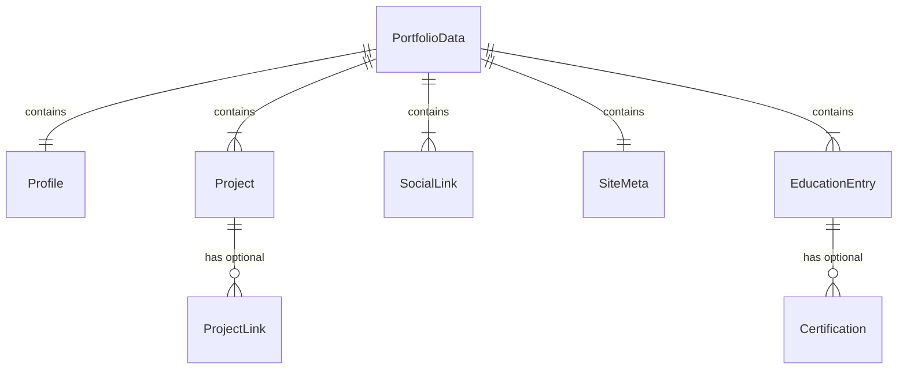

# Data Model: Portfolio Enhancements — i18n, Education & Certifications

**Feature**: `002-portfolio-enhancements`
**Date**: 2026-10-19
**Spec**: [spec.md](./spec.md)

## Supported Languages

```typescript
type Locale = "es" | "en";
```

Only two locales are supported. Spanish is the default.

---

## Entity: Localized\<T\>

A utility type that wraps any value with per-locale variants.

```typescript
type Localized<T> = Record<Locale, T>;
```

**Usage**: Any field that contains user-visible text must be wrapped in `Localized<string>` (or `Localized<string[]>` for arrays of strings).

**Example**:
```typescript
// Before (current)
{ name: "Agustín Beltrame" }

// After (localized)
{ name: { es: "Agustín Beltrame", en: "Agustín Beltrame" } }
```

> Non-translatable fields (URLs, image paths, IDs, boolean flags, numeric order) remain unwrapped.

---

## Entity: Profile (modified)

Extends the existing `Profile` interface with localized text fields.

| Field | Type | Localized | Required | Description |
|-------|------|-----------|----------|-------------|
| name | string | No | Yes | Full name (same in both languages) |
| role | string | Yes → `Localized<string>` | Yes | Professional role/title |
| headline | string | Yes → `Localized<string>` | Yes | One-line headline |
| bio | string | Yes → `Localized<string>` | Yes | Short biography |
| location | string | No | Yes | City, Country (same in both languages) |
| avatarUrl | string | No | Yes | Path to avatar image |
| cvUrl | string | No | Yes | Path to CV/resume PDF |
| availableForWork | boolean | No | Yes | Availability status flag |
| languages | string[] | Yes → `Localized<string[]>` | No | Spoken languages |
| coreTechnologies | string[] | No | No | Tech stack (not translatable) |

---

## Entity: Project (modified)

| Field | Type | Localized | Required | Description |
|-------|------|-----------|----------|-------------|
| id | string | No | Yes | Unique identifier |
| title | string | Yes → `Localized<string>` | Yes | Project title |
| description | string | Yes → `Localized<string>` | Yes | Project description |
| keyFeatures | string[] | Yes → `Localized<string[]>` | Yes | List of key features |
| tags | string[] | No | Yes | Technology tags (not translatable) |
| repoUrl | string | No | No | Repository URL |
| demoUrl | string | No | No | Demo URL |
| extraLinks | ProjectLink[] | No | No | Additional links |
| featured | boolean | No | Yes | Whether project is featured |
| order | number | No | Yes | Display order |

---

## Entity: ProjectLink (unchanged)

| Field | Type | Localized | Required | Description |
|-------|------|-----------|----------|-------------|
| label | string | Yes → `Localized<string>` | Yes | Link display text |
| url | string | No | Yes | Link URL |
| icon | "Github" \| "ExternalLink" | No | No | Icon identifier |

---

## Entity: SocialLink (modified)

| Field | Type | Localized | Required | Description |
|-------|------|-----------|----------|-------------|
| id | string | No | Yes | Unique identifier |
| platform | SocialPlatform | No | Yes | Platform name |
| url | string | No | Yes | Profile URL |
| label | string | Yes → `Localized<string>` | Yes | Accessible label |
| isEmail | boolean | No | No | Whether this is an email link |
| emailAddress | string | No | No | Email address |
| icon | string | No | Yes | Icon component name |

---

## Entity: SiteMeta (modified)

| Field | Type | Localized | Required | Description |
|-------|------|-----------|----------|-------------|
| siteUrl | string | No | Yes | Site URL |
| siteName | string | No | Yes | Site name |
| defaultTitle | string | Yes → `Localized<string>` | Yes | Page title |
| description | string | Yes → `Localized<string>` | Yes | Meta description |
| keywords | string[] | Yes → `Localized<string[]>` | Yes | SEO keywords |
| author | string | No | Yes | Author name |
| ogImage | string | No | Yes | OG image path |

---

## Entity: EducationEntry (new)

Represents a formal education entry (e.g., university degree).

| Field | Type | Localized | Required | Description |
|-------|------|-----------|----------|-------------|
| id | string | No | Yes | Unique identifier |
| institution | string | Yes → `Localized<string>` | Yes | Institution name |
| degree | string | Yes → `Localized<string>` | Yes | Degree/program name |
| startDate | string | No | Yes | Start date (YYYY-MM or YYYY format) |
| endDate | string \| null | No | Yes | End date or null if in progress |
| status | "in-progress" \| "completed" | No | Yes | Current enrollment status |
| description | string | Yes → `Localized<string>` | No | Optional additional description |
| certifications | Certification[] | No | No | Associated certifications |
| order | number | No | Yes | Display order |

### Validation Rules
- `startDate` must be a valid date string in YYYY or YYYY-MM format
- If `status` is `"completed"`, `endDate` must not be null
- If `status` is `"in-progress"`, `endDate` must be null
- `order` determines display order (ascending)
- At least one `EducationEntry` must exist (per SC-006)

---

## Entity: Certification (new)

Represents a certificate or credential earned.

| Field | Type | Localized | Required | Description |
|-------|------|-----------|----------|-------------|
| id | string | No | Yes | Unique identifier |
| name | string | Yes → `Localized<string>` | Yes | Certificate name |
| issuer | string | Yes → `Localized<string>` | Yes | Issuing organization |
| date | string \| null | No | No | Date obtained (YYYY-MM or YYYY format) |
| imageUrl | string \| null | No | No | Path to certificate image (relative to public/) |

### Validation Rules
- If `imageUrl` is provided, the "View Certification" button appears
- If `imageUrl` is null/undefined, no button is shown (FR-010, acceptance scenario 3)
- Images should be in optimized format (WebP preferred, FR-015)
- At least one `Certification` with a non-null `imageUrl` must exist (per SC-006)

---

## Entity: PortfolioData (modified root)

| Field | Type | Required | Description |
|-------|------|----------|-------------|
| profile | Profile | Yes | Personal profile data |
| projects | Project[] | Yes | Project entries |
| socialLinks | SocialLink[] | Yes | Social/contact links |
| meta | SiteMeta | Yes | SEO metadata |
| education | EducationEntry[] | Yes | Education entries (new) |

---

## Entity: UITranslations (new)

Contains all hardcoded UI strings that appear in components but are not part of the data model.

| Key | Type | Description |
|-----|------|-------------|
| nav.about | string | Navigation link "About" / "Sobre mí" |
| nav.projects | string | Navigation link "Projects" / "Proyectos" |
| nav.education | string | Navigation link "Education" / "Educación" |
| nav.contact | string | Navigation link "Contact" / "Contacto" |
| hero.availableForWork | string | Badge text "Available for work" |
| hero.languages | string | Label "Languages:" |
| hero.downloadResume | string | Button "Download Resume / CV" |
| hero.contactMe | string | Button "Contact Me" |
| projects.title | string | Section title "Featured Projects" |
| projects.subtitle | string | Section subtitle |
| projects.viewRepo | string | Link label "View Repository" |
| projects.liveDemo | string | Link label "Live Demo" |
| education.title | string | Section title "Education" |
| education.subtitle | string | Section subtitle |
| education.inProgress | string | Status "In progress" |
| education.completed | string | Status "Completed" |
| education.viewCertification | string | Button "View Certification" |
| education.certificationModalClose | string | Close button label |
| contact.title | string | Section title "Get in Touch" |
| contact.subtitle | string | Section subtitle |
| contact.copyEmail | string | Button "Copy" |
| contact.emailCopied | string | Feedback "Copied!" |
| footer.rights | string | "All rights reserved." |
| footer.builtWith | string | "Built with..." |
| lang.toggle | string | Language toggle aria-label |

---

## Relationships Diagram



## File Organization

```
src/
├── types/
│   └── portfolio.ts          # Updated with Locale, Localized<T>, EducationEntry, Certification
├── data/
│   ├── portfolioData.ts      # Restructured: default export with es/en content
│   └── translations.ts       # UITranslations for es and en
├── providers/
│   ├── ThemeProvider.tsx      # Existing (unchanged)
│   └── LanguageProvider.tsx   # New: language context + persistence
├── hooks/
│   ├── useLanguage.ts        # New: hook to access language context
│   └── useTranslation.ts     # New: hook to get t() function for UI strings
└── components/
    ├── Header.tsx             # Modified: add LanguageToggle, localized nav
    ├── LanguageToggle.tsx     # New: ES/EN toggle control
    ├── EducationSection.tsx   # New: renders education entries
    ├── EducationCard.tsx      # New: single education entry with certifications
    ├── CertificateModal.tsx   # New: accessible image viewer modal
    └── ...                    # Existing components updated for i18n
```
